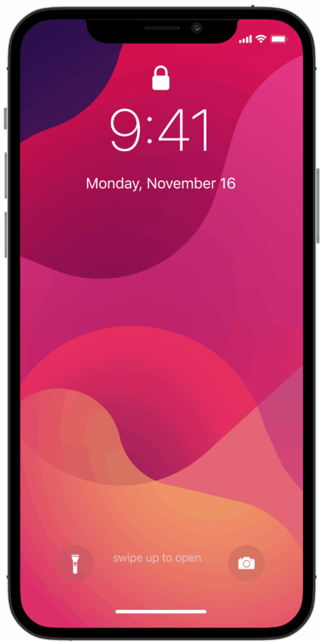
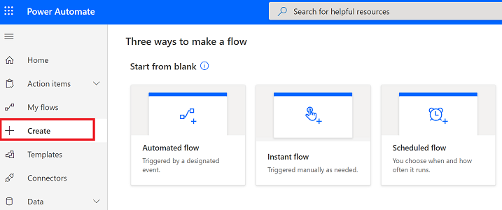
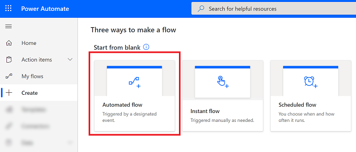
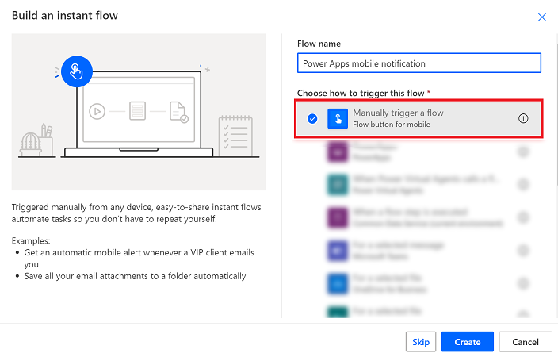
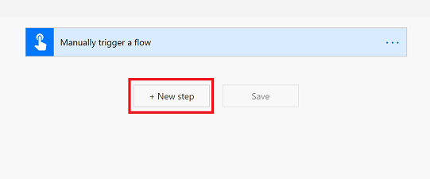
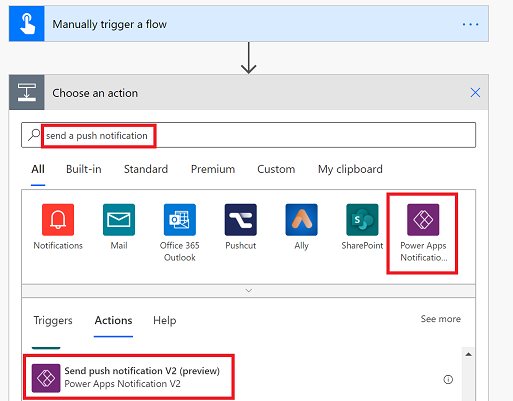
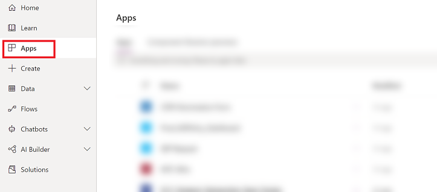
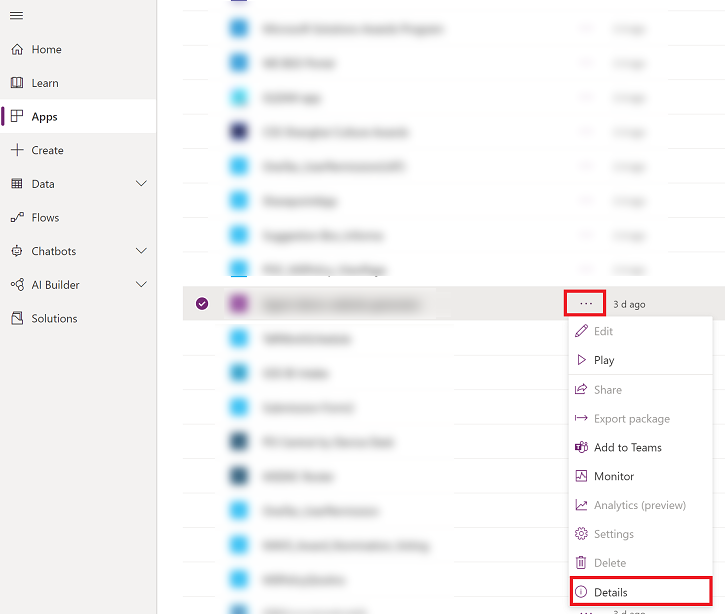
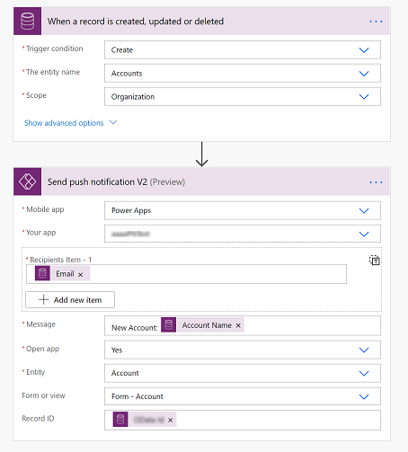
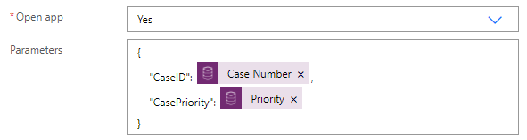

# Create push notifications for the Power Apps mobile app by using Power Automate

Use push notifications in Power Apps mobile to engage app users and help them prioritize key tasks. In Power Apps, you can create notifications for Power Apps mobile by using the Power Apps Notification connector. You can send notifications to any app that you create in Power Apps. 
 

Add a push notification to your app if:

* Your users need to know information immediately.
* Your users must complete important tasks by using your app, in a preloaded context.
* You want to engage your users on a specific interval, or you need users to enter the app in a specific context.

> [!NOTE]
> To receive push notifications, each user must open the app in Power Apps Mobile once or get the app from the [Microsoft 365 apps page](https://www.office.com/apps).

Before you can create a push notification, you need access to an app and the row ID if you're creating a notification for a form.

Create an app

You need **Contributor** permission for a model-driven app or canvas app. If you don't have an app, you can create one. For more information, see:

- [Create a model-driven app](../maker/model-driven-apps/build-first-model-driven-app.md)
- [Create a canvas app](../maker/canvas-apps/get-started-test-drive.md)
     
## Create a notification from a flow

When you trigger a push notification from a flow, you can send the notification to only one user or security group at a time.

1. Go to [Power Automate](https://make.powerautomate.com) and select **Create**.

   > [!div class="mx-imgBorder"] 
   > 

2. Select **Automated flow**.

   > [!div class="mx-imgBorder"] 
   > 

3. On the **Build an automated flow** screen, choose one of the flow triggers or select **Skip** and manually create one.

   > [!div class="mx-imgBorder"] 
   > 
   
   
 4. From the list of connectors and triggers, select **Microsoft Dataverse (current environment)**.  
 
    > [!div class="mx-imgBorder"] 
    > 
    
 5. Select the action that triggers the notification. 
 
    > [!div class="mx-imgBorder"] 
    > 
    
    
 6. Enter the trigger condition information and then select **New step**.  
 
    | Name | Description |
    | --- | --- |
    | Trigger condition |Select the condition for the notification. |
    | The table name |Select which table the notification is for. |
    | Scope |Select the scope. |
 
    > [!div class="mx-imgBorder"] 
    > 
 
7. In the **Choose an action** search box, enter **send push notification**. In the list of **Actions** choose **Send push notification V2**.
 
    > [!div class="mx-imgBorder"] 
    > 
 
 
 6. On the **Send push notification** screen, enter the following information:
 
 	- **Mobile app**: Select **Power Apps**.
	- **Your app**: Select the app that you want to set up the notification for. Model-driven apps and canvas apps have different parameters. The next step depends on the type of app you select here.
	
 7. Depending on the type of app that you selected in the previous step, do one of the following:
 
 - For a model-driven app, enter this information:
 
      - **Recipient Items-1**: Select how the flow is triggered.
      - **Message**: Enter the notification message.
      - **Open app**: Select whether to open the model-driven app or not when the user selects the notification.
      - **Table**: Select the table for the notification.
      - **Form or view**: Select whether the notification is for a form or view.
      - **Row ID**: If the notification is for a form, enter the row ID.

      

- For a canvas app, enter this information: 
    
     - **Recipient Items-1**: Select how the flow is triggered.
     - **Message**: Enter the notification message.
     - **Open app**: Select whether to open the canvas app when the user selects the notification.
     - **Parameters**: Key-value parameters to pass with the notification. Your push notification can pass specific parameters to the app. The app can process these parameters to open a specific page and load a specific state. For more information, see [Perform an action when a user taps the notification](power-apps-mobile-notification.md#perform-an-action-when-a-user-taps-the-notification).
	
8. When you're done, select **Save**. 
9. Select **Flow checker** to check for errors or warnings.
10. Test the flow by selecting **Test** and follow the prompts. 

## Perform an action when a user taps the notification

### Pass parameters

For canvas apps, you can pass key-value pairs by entering JSON in the **Parameters** field. For example, to pass the CaseID, enter the following JSON as **Parameters**:
` { "CaseID": 42 }`. You can also use dynamic values from earlier steps as shown in the following section.

### Read parameters

To read the passed parameters, use `Param("ParameterName")`. For example, to read the **CaseID** value, use `Param("CaseID")`. To quickly identify this parameter, add a **Label** control to your app. Set the **Text** property of that control to `Param("CaseID")`. If the user opens the app from the **All apps** list, the value is empty. If the user opens the app from another location on the device, the value is populated with the **CaseID** value.

### Set the start page

You can set your app to open, for example, the **Case details** page as soon as the app opens:

1. Add a **Timer** control, and set its **OnTimerEnd** property to this formula:

    `Navigate(EditCase, ScreenTransition.None)`

1. (optional) Hide the **Timer** control by setting its **Visible** property to **false**.

1. Set the **OnVisible** property of the screen to **Timer.Start()**.

> [!TIP]
> Create a unique first page in the app for the notification:
> 
> 1. Create an empty page that your app doesn't already open, add a **Text Input** control, and set its **timer.Duration** value.
> 2. When you create the app, set the timer to a non-zero value. When you're ready to publish the app, set the value to **0** to immediately trigger the timer.

## Considerations

* You can send a push notification from one app to another app or to the same app. For more information, see [Send notification from an app](../maker/canvas-apps/add-notifications.md).
* Notifications show the generic Power Apps icon instead of a specific app icon.
* Android devices in China don't support notifications.
* Battery optimization settings on an Android device can interfere with receiving notifications for Power Apps mobile. To receive notifications for Power Apps mobile, turn off battery optimization for the app.
* Power Apps mobile supports the example push notifications that are mentioned in this article. Other mobile apps such as  [Dynamics 365 Sales mobile app](/dynamics365/sales/sales-mobile/use-sales-mobile-app) or [Dynamics 365 for phones and tablets](/dynamics365/mobile-app/overview) don't support these types of notifications.

## Limitations

### Push notifications aren't supported in Shared Device Mode

- Power Apps mobile disables native push notifications when running in Microsoft Entra ID Shared Device Mode (SDM).
- To protect user privacy and eliminate compliance risks associated with cross-shift data exposure, the Power Apps Mobile app container purges background listener configurations and device tokens immediately upon global sign-out. As a result, the operating system can't map or route active push notification payloads to an unauthenticated or dynamic session state.
- If your application logic requires alerting frontline workers during their shift, implement **in-app notifications**. In-app alerts query data securely from Dataverse or your backend source *only* after a specific user context is authenticated within the Power Apps container.

For reference information, see [Power Apps Notification reference](/connectors/powerappsnotification/).

[!INCLUDE[footer-include](../includes/footer-banner.md)]
